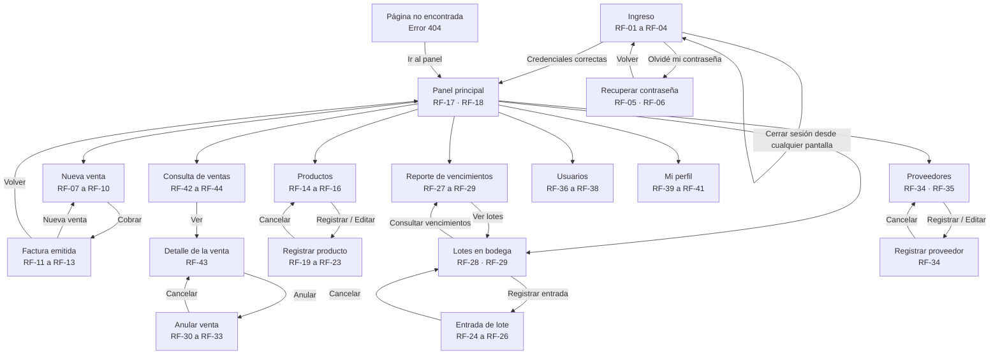

# Mapa de navegación · SGME

Cada nodo corresponde a una pantalla del prototipo (`prototipo/`) y a su
interfaz final. Entre paréntesis van los requisitos funcionales que cumple.

## Cómo se recorre

El ingreso es la única puerta: sin autenticarse no se llega a ninguna otra
pantalla. Desde el panel principal se alcanza todo el sistema, y el menú
superior está presente en todas las pantallas internas, de modo que ninguna
queda sin salida.

Hay tres recorridos que importan:

1. **Vender.** Ingreso → Panel → Nueva venta → Factura. Es el camino que más
   se repite en el día y por eso «Nueva venta» es la segunda opción del menú.
2. **Anular.** Panel → Consulta de ventas → Detalle → Anular. La anulación
   queda a tres clics y detrás de una confirmación, porque es irreversible.
3. **Controlar el vencimiento.** Panel → Reporte de vencimientos → Lotes. El
   indicador de «lotes por vencer» del panel lleva directo al reporte.

## Comprobación

El generador del prototipo verifica dos cosas antes de escribir los archivos y
se detiene si alguna falla:

- que todo enlace apunte a un nodo que exista, de modo que no haya enlaces
  rotos;
- que ninguna pantalla quede sin salida.

Las 18 pantallas pasaron las dos comprobaciones.
